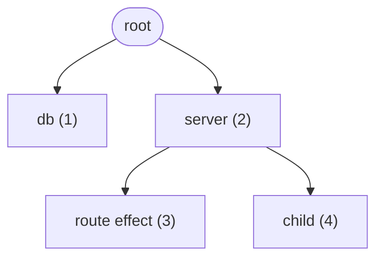
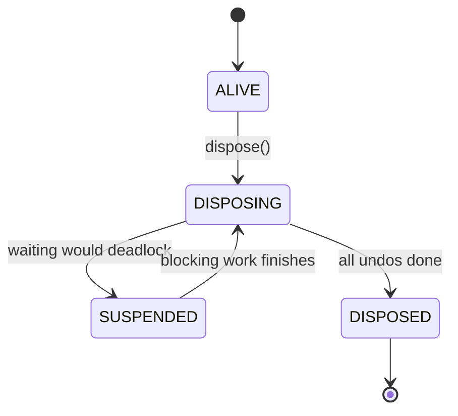

# z

A tiny, dependency-free Java kernel for **structured lifecycle management**: build a tree of resources and tasks, then tear it all down in the right order, exactly once, with no error lost.

[](https://adoptium.net/)
[](https://gradle.org/)
[](LICENSE)

[Overview](#overview) · [Quick start](#quick-start) · [Usage](#usage) · [Guarantees](#guarantees) · [Project structure](#project-structure) · [Development](#development)

## Overview

Opening a database, starting a server, registering routes: each step needs an undo, and the undos must run in reverse order, even when one of them fails or when several threads shut down at once.

`z` models this as a tree of **fibers**:

- A `Fiber` is a node in the teardown tree and owns an undo list.
- An `Effect` runs some work and returns how to undo it.
- A `Component` receives its own child fiber, creates more work in it, and returns its own cleanup.
- Disposing a fiber undoes everything in reverse start order, children before parents.

The `core` module has no library dependencies and is built to stay that way.

> [!NOTE]
> This project builds on the ideas of [cordis](https://github.com/cordiverse/cordis) by Shigma, "A Meta-Framework of Spatiotemporal Composability". Credit for the original concept goes to the cordis authors. See [Acknowledgements](#acknowledgements).

## Quick start

**Prerequisites:** JDK 21 (Gradle toolchains can download it for you). The Gradle wrapper is included.

```bash
git clone https://github.com/ismhac/z.git
cd z/java

# Run the example
./gradlew :examples:run

# Run the full test suite
./gradlew check
```

On Windows, use `gradlew.bat`.

## Usage

```java
Fiber root = Fiber.root("root");

// Component: gets its own child fiber, returns its own cleanup.
Disposable server = root.use("server", fiber -> {
  System.out.println("server: listen");

  // Effect: run work, return how to undo it.
  fiber.effect("route", signal -> {
    System.out.println("add route /a");
    return () -> System.out.println("remove route /a");
  });

  return () -> System.out.println("server: stop");
});

server.dispose();  // remove route /a -> server: stop
root.dispose();    // disposes whatever is left
```

The code above builds this tree. Numbers show the order of creation:



Disposing `server` undoes its contents in reverse start order, children before the parent: `child` → `route` → `server`. Each branch has its own undo list, so `db` is untouched until `root` is disposed. See [`Main.java`](java/examples/src/main/java/Main.java) for a complete tree written with named classes instead of lambdas.

### Core API

| Type | Role |
| --- | --- |
| `Fiber` | Teardown tree node. `root()`, `effect()`, `use()`, `dispose()`, `awaitDisposed()`, `describe()` |
| `Effect` | `Disposable run(Signal signal)`: do work, return its undo (or `null`) |
| `Component` | `Disposable apply(Fiber fiber)`: build a sub-tree, return its own cleanup |
| `Signal` | Read-only cancellation signal, cancelled when the owning fiber starts disposing |
| `Disposable` | Something that can be undone |
| `DisposeException` | All errors collected during teardown, each with its source |

> [!TIP]
> Long-running effects should check the `Signal` or register with `onCancel` so teardown does not have to wait for them to finish.

## Guarantees

A fiber moves in one direction only. If finishing a disposal would require waiting on itself or closing a deadlock cycle, the disposal is suspended and the thread holding the blocking work resumes it, in the correct order, once that work finishes.



- **Ordering:** disposal runs in reverse start order, children before parents.
- **Exactly once:** each undo runs at most once, even with concurrent `dispose()` calls.
- **No silent loss:** one failing undo does not stop the rest; errors are gathered into a `DisposeException`. Fatal JVM errors are rethrown unchanged.
- **Deadlock avoidance:** a wait graph detects cycles before waiting; teardown defers and resumes in order instead of deadlocking.
- **Unbounded depth:** teardown and cancellation are iterative, not recursive.
- **Isolation:** a component only sees its own fiber, never its parent.
- **No user code under locks:** `run`, undo and listeners never execute while the core holds a lock.

> [!NOTE]
> Java cannot safely stop a hung thread, so a stuck `run()` or undo cannot be forcibly killed. Use `awaitDisposed(timeout)` and `describe()` to detect it. Work that never returned an undo (an `Effect` that throws after opening something) must clean up after itself.

## Project structure

```text
java/
├── core/        Lifecycle kernel (Fiber, Signal, Teardown, WaitGraph, ...)
├── examples/    Example program using core
└── buildSrc/    Shared Gradle conventions (Java 21, -Xlint:all -Werror)
```

## Acknowledgements

The idea of composing resources and tasks into a lifecycle-managed tree comes from [cordis](https://github.com/cordiverse/cordis) (MIT, Copyright (c) 2021-present Shigma) and its accompanying paper, "A Programming Paradigm for Spatiotemporal Composability". `z` is a Java project built on that idea. The cordis MIT notice is reproduced in [LICENSE](LICENSE). If you work in TypeScript/JavaScript, check out the original.

## Development

All compiler warnings are errors. Tests are plain programs with `main()` (no JUnit), run through `core.AllTests`: component tests first, then composition and stress tests only if those pass.

```bash
cd java
./gradlew :core:coreTests   # run the core test suite
./gradlew check             # same, as part of the standard lifecycle
```
