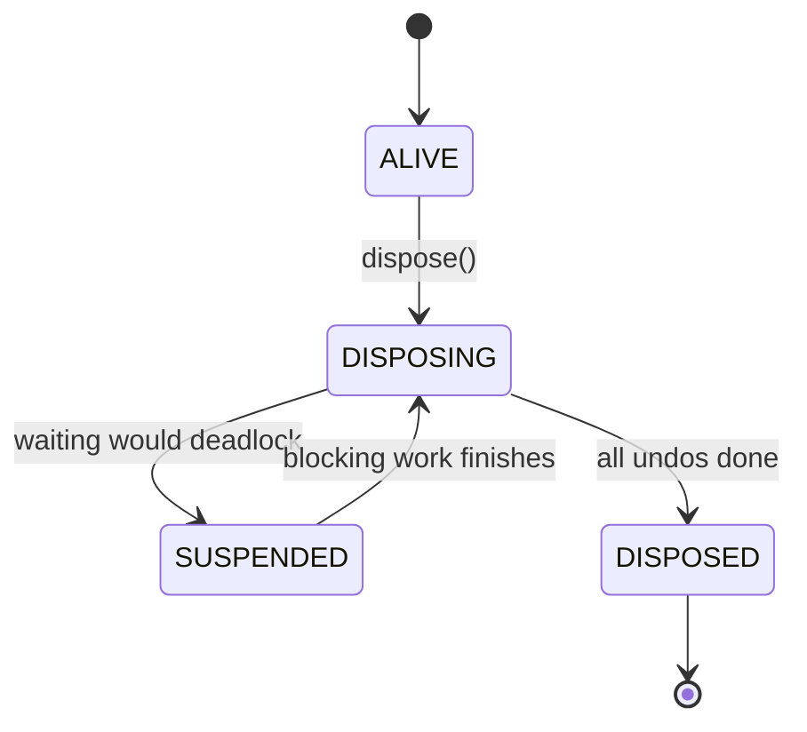

# z

A tiny, dependency-free Java kernel for **structured lifecycle management**: build a tree of resources and tasks, then tear it all down in the right order, exactly once, with no error lost.

[](https://adoptium.net/)
[](https://gradle.org/)
[](LICENSE)

[Overview](#overview) · [Quick start](#quick-start) · [Usage](#usage) · [Guarantees](#guarantees) · [Project structure](#project-structure) · [Development](#development)

## Overview

Opening a database, starting a server, registering routes: each step needs an undo, and the undos must run in reverse order, even when one of them fails or when several threads shut down at once.

`z` models this as a tree of **fibers**:

- A `Fiber` is a node in the teardown tree and owns an undo list.
- An `Effect` runs some work and returns how to undo it.
- A `Component` receives its own child fiber, creates more work in it, and returns its own cleanup.
- Disposing a fiber undoes everything in reverse start order, children before parents.

On top of the tree, the `context` module adds **plugins and services**:

- A `Plugin` declares the services it `requires()` and runs only while all of them are provided.
- `ctx.provide(key, impl)` publishes a service; retracting it first disposes every plugin that depends on it, then lets the provider clean up.
- When the services come back, dependent plugins are applied again in a fresh context.
- `ctx.on(event, listener)` and `ctx.hook(hook, handler)` live as long as the plugin that registered them.
- A `ConfigPlugin<C>` takes a config; changing it at runtime reconfigures or restarts only that plugin's branch.
- `ctx.spawn(name, job)` runs a job on a virtual thread; disposing its owner cancels it and waits until it returns.

`core` and `context` have no library dependencies and are built to stay that way.

> [!NOTE]
> This project builds on the ideas of [cordis](https://github.com/cordiverse/cordis) by Shigma, "A Meta-Framework of Spatiotemporal Composability". Credit for the original concept goes to the cordis authors. See [Acknowledgements](#acknowledgements).

## Quick start

**Prerequisites:** JDK 21 (Gradle toolchains can download it for you). The Gradle wrapper is included.

```bash
git clone https://github.com/ismhac/z.git
cd z/java

# Run the examples
./gradlew :examples:run          # core: fibers, effects, components
./gradlew :examples:runPlugins   # context: plugins, services, events, config, tasks

# Run the full test suite
./gradlew check
```

On Windows, use `gradlew.bat`.

## Usage

```java
Fiber root = Fiber.root("root");

// Component: gets its own child fiber, returns its own cleanup.
Disposable server = root.use("server", fiber -> {
  System.out.println("server: listen");

  // Effect: run work, return how to undo it.
  fiber.effect("route", signal -> {
    System.out.println("add route /a");
    return () -> System.out.println("remove route /a");
  });

  return () -> System.out.println("server: stop");
});

server.dispose();  // remove route /a -> server: stop
root.dispose();    // disposes whatever is left
```

The code above builds this tree. Numbers show the order of creation:


Disposing `server` undoes its contents in reverse start order, children before the parent: `child` → `route` → `server`. Each branch has its own undo list, so `db` is untouched until `root` is disposed. See [`Main.java`](java/examples/src/main/java/Main.java) for a complete tree written with named classes instead of lambdas.

### Plugins and services

```java
ServiceKey<Db> DB = ServiceKey.of("db", Db.class);
Root root = Context.root("app");

// Waits until DB exists; disposed as soon as DB is retracted, applied again when it returns.
root.plugin("server", Plugin.require(DB).then(ctx -> {
  Db db = ctx.get(DB);            // only declared services are reachable
  System.out.println("server: start on " + db.url());
  return () -> System.out.println("server: stop");
}));

PluginHandle db = root.plugin("db", ctx -> {
  ctx.effect("conn", s -> () -> System.out.println("db: close"));
  ctx.provide(DB, () -> "pg://local");   // server starts here, on this thread
  return null;
});

db.dispose();    // server: stop -> db: close
root.dispose();  // disposes whatever is left
```

| Type | Role |
| --- | --- |
| `Context` | What a plugin sees: `effect()`, `use()`, `plugin()`, `provide()`, `get()`, `signal()` |
| `Root` | Top-level context: `Context.root()`, `dispose()`, `awaitDisposed()`, `describe()` |
| `Plugin` | `Disposable apply(Context ctx)` plus `requires()`; `Plugin.require(keys...).then(body)` |
| `ServiceKey<T>` | Typed service name; same name and type means same service |
| `PluginHandle` | Uninstalls a plugin for good; `isActive()` |
| `ErrorHandler` | Receives failures with no caller (a plugin started by another thread's `provide()`) |
| `EventKey<E>`, `Listener<E>` | Typed event and its observer: `on()`, `emit()` |
| `HookKey<E, R>`, `Hook<E, R>` | Typed request and its handler: `hook()`, `bail()`, `collect()` |
| `EmitException` | Every listener failure of one `emit()` / `collect()`, each with its source |
| `ConfigPlugin<C>`, `ConfigHandle<C>` | Plugin with a config: `apply(ctx, config)`, `reconfigure()`; `update()`, `config()` |
| `Job<T>`, `Task<T>` | Work on a virtual thread: `spawn()`; `await()`, `isDone()`, `dispose()` |

Service guarantees, in addition to the core ones:

- **Dependents first:** retracting a service disposes its dependents (newest first, cascading through chains) before the provider's own cleanup runs, including during `root.dispose()`.
- **No use after retract:** if a dependent's `apply()` is still running on another thread, the retraction waits for it through the core, so deadlock avoidance still applies.
- **One provider per key:** a second `provide()` of a key throws `ServiceConflictException` until the first is retracted.
- **Tracked lifetimes:** `ctx.get()` only returns services declared in `requires()`.
- **Failures:** a plugin applied immediately throws to the `plugin()` caller; one started by a provider reports to the `ErrorHandler` and is retried when its services change.

### Events and hooks

```java
EventKey<String> MSG = EventKey.of("msg", String.class);
HookKey<String, Integer> ASK = HookKey.of("ask", String.class, Integer.class);

root.plugin("logger", ctx -> {
  ctx.on(MSG, m -> System.out.println("got " + m));  // removed when "logger" is disposed
  ctx.hook(ASK, q -> q.length());
  return null;
});

root.emit(MSG, "hi");                    // every listener, in registration order
Optional<Integer> n = root.bail(ASK, "four");     // first non-null answer: 4
List<Integer> all = root.collect(ASK, "four");    // every non-null answer
```

- **No call after unregistration:** each call runs as an effect in the registration's own fiber. Unregistering waits (through the core) for calls still running on other threads, and refuses new ones. A listener may unregister itself during its own call.
- **No silent loss:** `emit` and `collect` run every listener, then throw all failures together as an `EmitException`. `bail` throws at the first failure.
- **Typed:** an event or answer of the wrong type is rejected with `ClassCastException`.

### Config and hot reload

```java
record DbConfig(String url) {}

ConfigHandle<DbConfig> db = root.plugin("db", (ctx, cfg) -> {
  ctx.provide(DB, cfg::url);
  return () -> System.out.println("db: close " + cfg.url());
}, new DbConfig("pg://one"));

db.update(new DbConfig("pg://two"));  // restarts only "db"; its dependents follow the service rules
```

- **Only this branch:** an update disposes and re-applies only that plugin. Plugins that depend on a service it provides are stopped first and started again with the new service. The rest of the tree is untouched.
- **In place when possible:** override `reconfigure(ctx, previous, next)` and return `true` to apply a change without restarting. It runs inside the instance's fiber, so a concurrent disposal waits for it.
- **Converges on the latest config:** configs are compared with `equals()` (records are ideal). One thread updates a plugin at a time; concurrent or re-entrant `update()` calls are coalesced and the newest config wins. A plugin waiting for services just records it.
- **Failures:** a failing restart or `reconfigure()` throws to the `update()` caller, and the plugin is left stopped (never half-updated) until the next update or service change.

### Tasks

```java
Task<String> t = ctx.spawn("fetch", signal -> {
  return http.get(url);          // blocking I/O is interrupted when the task is cancelled
});
String body = t.await();         // the job's result, or its exception unchanged
t.dispose();                     // cancel and wait until the job has returned
```

- **Owned by the tree:** each job runs on its own virtual thread, as an effect in a child fiber. Disposing the task, its plugin or the root cancels the signal, interrupts the thread, and **waits until the job returns** (deadlock-safe, through the core), so nothing it uses is cleaned up under it.
- **No silent loss:** a job that fails (other than by being cancelled) is reported to the `ErrorHandler` and also thrown by `await()`. A cancelled job's `await()` throws `CancelledException`.
- **No self-deadlock:** a job awaiting its own task gets `DeadlockException`; a job may dispose its own task.

### Core API

| Type | Role |
| --- | --- |
| `Fiber` | Teardown tree node. `root()`, `effect()`, `use()`, `dispose()`, `awaitDisposed()`, `describe()` |
| `Effect` | `Disposable run(Signal signal)`: do work, return its undo (or `null`) |
| `Component` | `Disposable apply(Fiber fiber)`: build a sub-tree, return its own cleanup |
| `Signal` | Read-only cancellation signal, cancelled when the owning fiber starts disposing |
| `Disposable` | Something that can be undone |
| `DisposeException` | All errors collected during teardown, each with its source |

> [!TIP]
> Long-running effects should check the `Signal` or register with `onCancel` so teardown does not have to wait for them to finish.

## Guarantees

A fiber moves in one direction only. If finishing a disposal would require waiting on itself or closing a deadlock cycle, the disposal is suspended and the thread holding the blocking work resumes it, in the correct order, once that work finishes.



- **Ordering:** disposal runs in reverse start order, children before parents.
- **Exactly once:** each undo runs at most once, even with concurrent `dispose()` calls.
- **No silent loss:** one failing undo does not stop the rest; errors are gathered into a `DisposeException`. Fatal JVM errors are rethrown unchanged.
- **Deadlock avoidance:** a wait graph detects cycles before waiting; teardown defers and resumes in order instead of deadlocking.
- **Unbounded depth:** teardown and cancellation are iterative, not recursive.
- **Isolation:** a component only sees its own fiber, never its parent.
- **No user code under locks:** `run`, undo and listeners never execute while the core holds a lock.

> [!NOTE]
> Java cannot safely stop a hung thread, so a stuck `run()` or undo cannot be forcibly killed. Use `awaitDisposed(timeout)` and `describe()` to detect it. Work that never returned an undo (an `Effect` that throws after opening something) must clean up after itself.

## Project structure

```text
java/
├── core/        Lifecycle kernel (Fiber, Signal, Teardown, WaitGraph, ...)
├── context/     Plugins, services, events, config and tasks on top of core (Context, Plugin, ...)
├── examples/    Example programs (Main: core, PluginsMain: context)
└── buildSrc/    Shared Gradle conventions (Java 21, -Xlint:all -Werror)
```

## Acknowledgements

The idea of composing resources and tasks into a lifecycle-managed tree comes from [cordis](https://github.com/cordiverse/cordis) (MIT, Copyright (c) 2021-present Shigma) and its accompanying paper, "A Programming Paradigm for Spatiotemporal Composability". `z` is a Java project built on that idea. The cordis MIT notice is reproduced in [LICENSE](LICENSE). If you work in TypeScript/JavaScript, check out the original.

## Development

All compiler warnings are errors. Tests are plain programs with `main()` (no JUnit), run through `core.AllTests`: component tests first, then composition and stress tests only if those pass.

```bash
cd java
./gradlew :core:coreTests        # run the core test suite
./gradlew :context:contextTests  # run the context test suite
./gradlew check                  # all of the above
```
