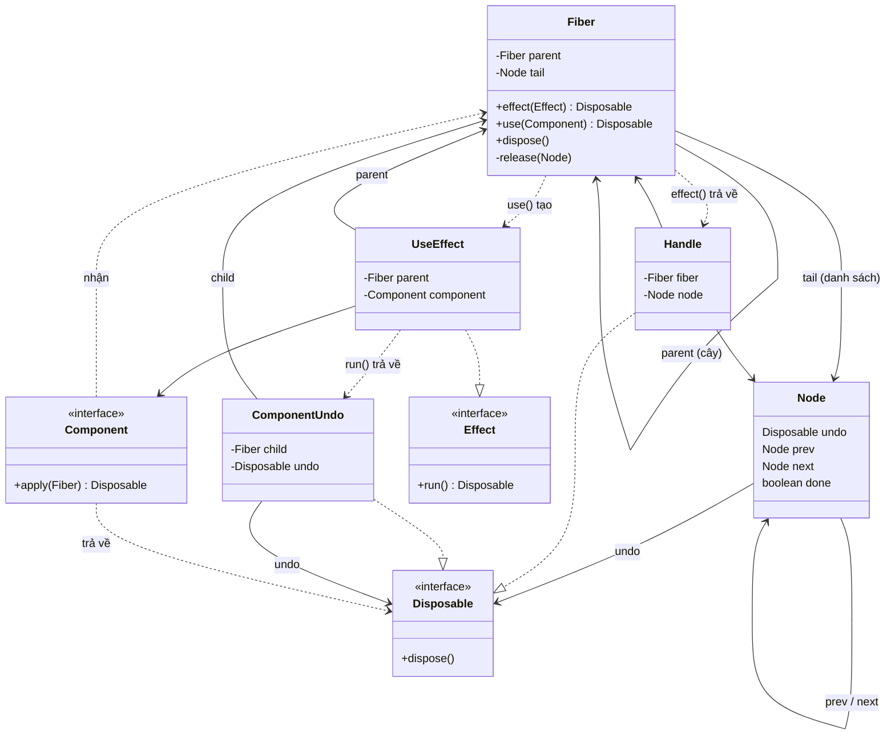

# Quan hệ giữa các class (seft-write)

Mũi tên liền (`-->`) là field, mũi tên đứt (`..>`) là dùng tạm, `..|>` là implements.
`Handle`, `UseEffect`, `ComponentUndo` là class lồng (private static) trong `Fiber`, thay cho các lambda cũ.
